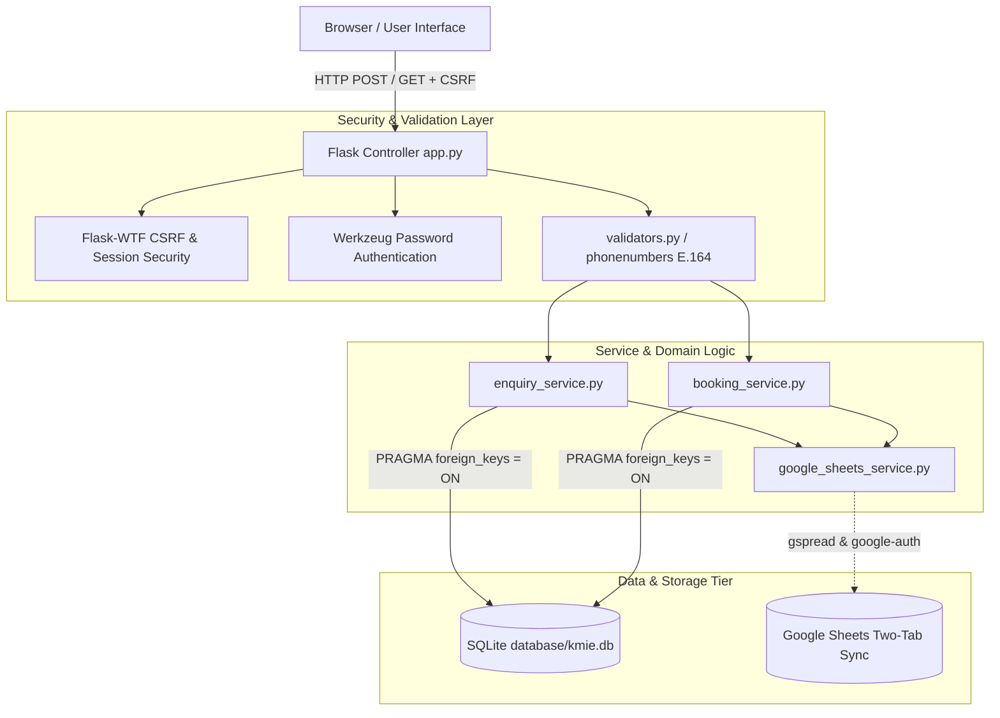
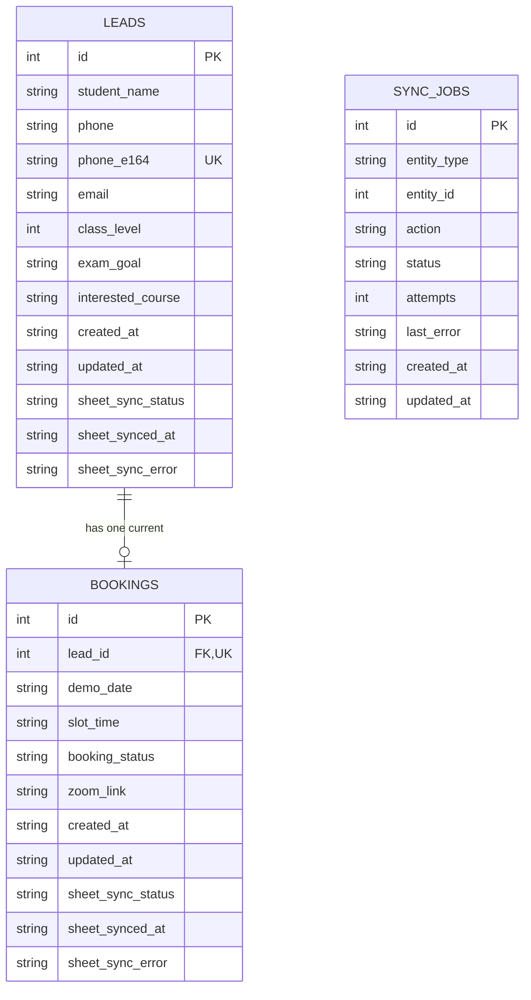
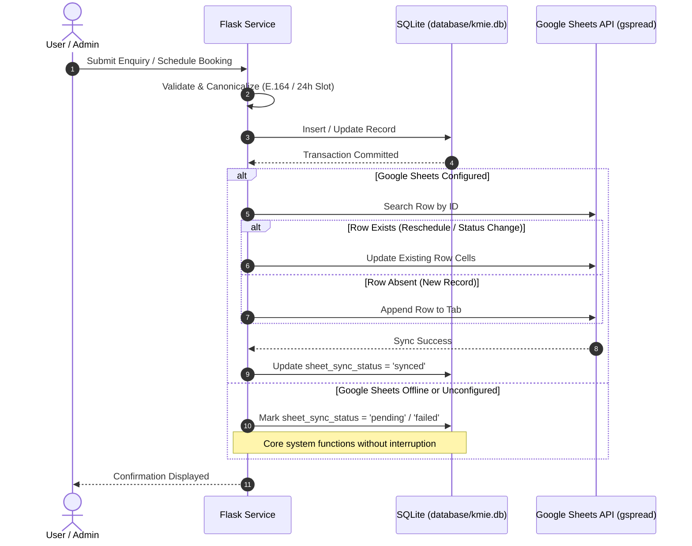

# Architecture & Technical Design

## 1. System Overview

The **KMIE Student Enquiry & Demo Booking Automation System** is built on a layered Python Flask architecture backed by an embedded, persistent **SQLite** database (`database/kmie.db`) as the primary system of record, coupled with an asynchronous **Google Sheets** synchronization engine.

---

## 2. Core Architecture Components

### A. Frontend Layer (Jinja2, HTML5, CSS3, Vanilla JS)
- **Public Student Portal (`templates/index.html`)**:
  - Student enquiry submission form with client-side & server-side validation.
  - Honeypot anti-spam protection (`website_url` hidden field).
  - Demo booking scheduler with date validation (today or future dates only) and 4 fixed slots (`1:00 PM`, `3:00 PM`, `5:00 PM`, `7:00 PM`).
  - Read-only real-time records table and status counters.
- **Protected Administrator Console (`templates/admin_dashboard.html`)**:
  - Authenticated session management (`@admin_required`).
  - Search and multi-criteria filtering by student name, phone, class, and exam goal.
  - Inline demo slot booking and rescheduling.
  - Real-time status update toggle (`Booked`, `Attended`, `Not Attended`).
  - One-click Google Sheets retry synchronization trigger.
- **Styling (`static/css/style.css`)**:
  - Clean light-mode design with **Emerald & Teal accents**, glassmorphic header, accessible contrast, responsive breakpoints (desktop, tablet, mobile).

### B. Business Logic & Validation Layer
- **`services/validators.py`**:
  - Leverages Google's `phonenumbers` library with region `'IN'`. Normalizes all valid formats (`9876543210`, `+91 98765 43210`, `0091 ...`, `0...`) to canonical **E.164** (`+919876543210`).
  - Enforces field rules: RFC-compliant email, class level (11 or 12), exam goal (NEET or JEE), and course selections.
- **`services/enquiry_service.py`**:
  - Prevents duplicate student leads at both application and database levels (`UNIQUE(phone_e164)`).
  - Records creation timestamps in UTC ISO-8601.
  - Initiates Google Sheets synchronization upon successful commit.
- **`services/booking_service.py`**:
  - Associates each booking with an existing lead ID (`FOREIGN KEY REFERENCES leads(id) ON DELETE CASCADE`).
  - Enforces `UNIQUE(lead_id)`: one current booking per student. Rescheduling updates the existing row in-place rather than creating duplicate booking entries.
  - Formats demonstration confirmations with the configurable `DEMO_MEETING_URL` placeholder.
- **`services/auth_service.py`**:
  - Uses `werkzeug.security` (`scrypt`/`pbkdf2`) password hash verification.
  - Enforces HTTP-only session cookies with `SameSite=Lax`.

---

## 3. SQLite Database Design (`database/kmie.db`)

### Constraints & Indexes
1. **`leads.phone_e164`**: Enforced `UNIQUE` constraint preventing duplicate leads under any formatting style.
2. **`bookings.lead_id`**: Enforced `UNIQUE` foreign key referencing `leads(id) ON DELETE CASCADE`.
3. **`PRAGMA foreign_keys = ON;`**: Executed on every connection to maintain relational integrity.
4. **Performance Indexes**:
   - `idx_leads_phone_e164`, `idx_leads_created_at`, `idx_leads_sync_status`.
   - `idx_bookings_lead_id`, `idx_bookings_demo_date`, `idx_bookings_status`, `idx_bookings_sync_status`.

---

## 4. Google Sheets Synchronization Workflow

